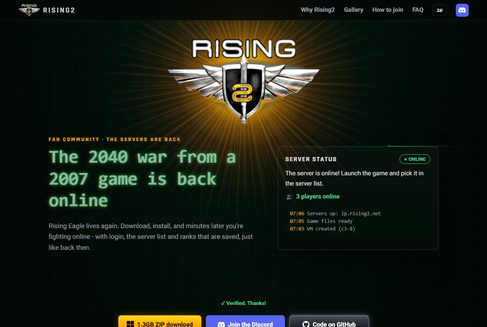

# Rising2 LandingPage

Static page for Cloudflare Pages: `index.html`, `style.css`, `app.js`, `assets/`.
No build step. Hebrew by default, English with the toggle (remembered per browser).



[Hebrew (default)](docs/screenshot-he.png) · [whole page](docs/screenshot-full.png).
The shots come from a local run against a stand-in API (server "online", 3 players), not the live site.

Sections: banner with **Direct download** + Discord, live server status, "why Rising2"
(direct download, open source, free, play now), gallery, how to join (3 steps), about.

* Live server status from `GET /api/status` (refreshes every 8 s while starting/stopping, else every minute).
* One Cloudflare Turnstile check under the logo unlocks everything: the page trades its token for a
  10-minute pass bound to the visitor's IP (`POST /api/session`, renewed with each new token, ~5 min)
  and sends it as `x-pass` with every call. Until then the status,
  the links (Discord, GitHub, download: from R2 `site/urls.json`) and the file archive
  (`site/s3files.json`, 10-minute signed S3 links) stay locked, so crawlers get nothing.
* When the server is asleep: **Wake the server** -> `POST /api/start` (once a day per IP).

## To fill in

* `CONFIG` at the top of [app.js](app.js): only the Turnstile site key (Deploy step 07 sets it; the
  default is Cloudflare's always-pass test key). The links live in R2 (Deploy steps 05a / 05b, `../SiteData`).
* Gallery videos in [index.html](index.html): `<figure data-yt="YOUTUBE_ID">` and its
  `<figcaption>`. An empty id shows a "video coming soon" slide; the player loads only on click
  (youtube-nocookie).
* More images: drop a JPG (16:9 looks best) in `assets/gallery/` and add a `<figure>`.
  The current ones come from the game guide PDF, the menu art and an in-game screenshot.

```powershell
npx wrangler pages deploy . --project-name rising2
```

Then add `rising2.net` and `www.rising2.net` as custom domains of the Pages project.
The worker's routes (`rising2.net/api/*`) sit in front of it, so the page calls the API on its own origin.
