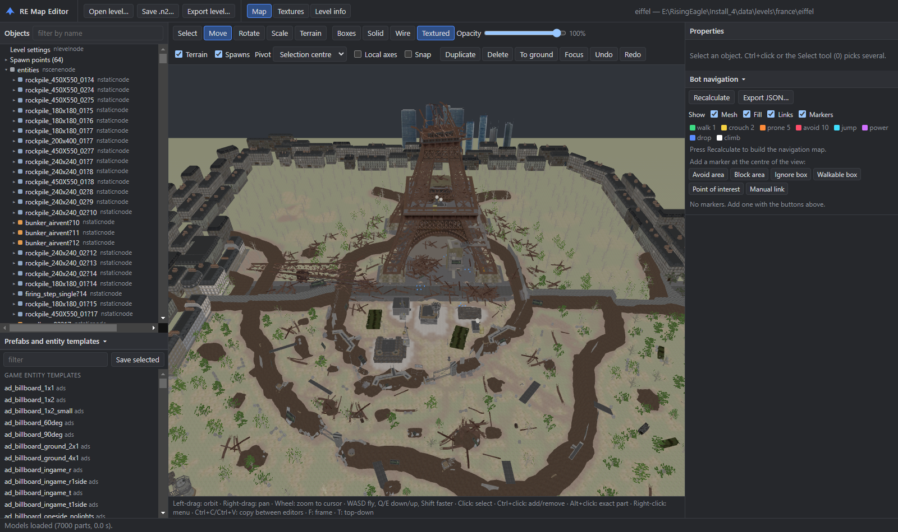

# Rising Eagle Map Editor

An Electron + JavaScript editor for Rising Eagle (Nebula Device 2) levels.



```bash
npm install
npm start
```

Then use **Open level…** and pick a level folder, for example
`E:\RisingEagle\Install_4\data\levels\france\eiffel`. The game folder (the one that holds
`data\levels`) is found by walking up from there. The editor remembers the last level and
reopens it on the next start. `npm start -- --level <folder>` opens a specific one.

The editor never writes into the game folder unless you point a save or export there yourself.
By default, output goes to `output\<level>` inside this project.

## What it does

### Level 1: objects and properties
- **Tree on the left:** the level's node tree (`entities`, `sky`, `terrain`), plus *Level settings*
  and *Spawn points*. Type in the box to filter by name.
- **Viewport:** every part with a `.setlocalbox` is drawn as a box, coloured by kind: grey-blue static,
  orange breakable, green tree, red turret, yellow flag, purple billboard.
- **Selecting:**
  - Click selects a whole placed object, Ctrl+click adds or removes one, and Alt+click picks the exact part.
  - The **Select** tool (0) selects with a dragged rectangle; Ctrl or Shift+drag adds to the selection. In that tool, middle-drag orbits.
  - In the tree, Ctrl+click and Shift+click (range) work too. Ctrl+A selects every placed object.
- **Camera:**
  - Left-drag orbits, right-drag pans, and the wheel zooms towards the cursor. Panning keeps a usable speed when zoomed in close.
  - **WASD** flies along the view, **Q/E** moves down and up, and **Shift** is 4× faster. Flying speed grows with height above the ground.
  - **F** frames the selection. **T**, or double-clicking a row in the tree, gives a top-down close-up (north up, like the minimap).
- **Gizmo:** Move (1), Rotate (2), Scale (3), Terrain brush (4). *Snap* gives 0.5 m and 15° steps.
- **Several objects at once:** Move, Rotate and Scale act on the whole selection. **Pivot** chooses the rotation and scale centre:
  - *Selection centre* — the middle of the selection's bounding box.
  - *Active object* — the one picked last.
  - *Each own origin* — every object turns and scales in place.
  - *Local axes* lines the gizmo up with the active object's rotation.
- **Editing:** Duplicate (Ctrl+D), Delete (Del), To ground (G), Undo/Redo (Ctrl+Z / Ctrl+Y). All of these work on the whole selection, spawn points included.
  Right-click an object, a spawn point or a tree row for a menu with the same actions.
- **Copy between levels:** **Ctrl+C** puts the selection on the Windows clipboard. **Ctrl+V** in any running editor pastes it at the same coordinates;
  **Ctrl+Shift+V** pastes it at the centre of the view, keeping each object's height above the ground.
  Start the editor twice (`npm start` in two terminals) to have two levels open side by side.
  Objects pasted into another level have no baked lighting there, so they look fully lit in game.
- **Properties on the right:** every `.command args` line of the node is editable, and you can add or remove commands.
  Hovering or focusing a command shows its argument types. These are read from the game exe, for example
  `v_setinsertionpoint_iiffffff`.
- **Spawn points** (`.setinsertionpoint side group x y z rx ry rz`) are blue/red cones that can be moved, copied and deleted.
- **Save .n2… (Ctrl+S):** writes the level script only. An unchanged level is written back byte for byte.

### Level 2: models
Views: **Boxes / Solid / Wire / Textured** (keys 5–8). Models come from the game's `.nvx2` / `.n3d2`
files, and each part uses the mesh group named by `.setgroupindex`. The Eiffel level (7,000 parts) loads in 1–3 s.
The textured view hides parts the game does not draw (`.setactive false`, for example the map borders).

### Level 3: Export level…
Writes a complete level folder and rebuilds what depends on your edits. The dialog lists every step with an
on/off switch and a ▸ button that explains it:
- Steps that don't apply are switched off with the reason shown (for example "The terrain was not edited").
- Required steps are locked on.
- **Point to the original level's big textures instead of copying them** (off by default): for a variant of a level every
  player already has. The baked-lighting pictures (`maps\lightmap*.dds`), object atlases (`maps\atl*.dds`) and grass atlas
  (`maps\speedgrass*.dds`) stay in the original folder. `lightmap.mdat`, `static.tai` and `speedgrass.tai` point to them there.
  Files the game finds by name in the level's own folder (`grass.dat`, `terrain\`, minimaps, `lightmap.mdat`, `atl*_nl.dds`) are still copied.
  For Eiffel the export shrinks from 71 MB to 41 MB. Only available when the level gets a new name or game path.
- **Leave the grass out** (off by default): `grass.dat` is a text list with one `b x z size …` line per grass clump
  (Eiffel: 348,000 lines, 12.6 MB). The game finds it by name, so it cannot be shared; this writes an empty one
  (same header, no clumps, about 100 bytes). With both options on, Eiffel exports at 28 MB.
- A second list shows what the export does **not** do yet (re-baking light, grass, mission files…). Those switches cannot be turned on.

| File | What happens |
|---|---|
| `<name>.n2` | Your edits. If you give the level a new name or game path, every internal path is rewritten |
| `maps\lightmap.mdat` | Baked lighting is looked up by `CRC32("/usr/level/" + node path)`. Copied and renamed objects get their original's lighting, and deleted ones are removed. **Light is not re-baked**, so moved objects keep their old shading. |
| `terrain\textures\heightmap.bmp` | Only if the terrain was edited. Also updates `.setminheight` / `.setmaxheight` and sets `.setfixterrain false` so the engine builds the terrain mesh itself (see *Not verified* below) |
| `level_map.dds`, `level_map_menu.dds` | Optional. A textured top view of the square `.setmapoffset x z` … `+ terrainSize × scale` |
| `<name>.dds` | Optional. The menu picture, rendered from the current camera |
| `<name>.dat`, `static.tai`, `maps\speedgrass.tai`, `<name>.flsproj` | Path and name updates; menu texts from the *Level info* tab |
| `<name>.bin` | Removed when objects were added or removed (a render cache; see *Not verified* below) |

The log ends with the line to add to `gameserver.tcl`, for example
`.addlevel <n> "home:data/levels/france/eiffel2/eiffel2.n2"`.

### Level 4: terrain
Use the **Terrain** mode (4). The brush can raise, lower, flatten to a height, or smooth.
Shift+click picks the flatten height, and *Flatten all…* sets the whole terrain to one height.
Heights are stored as `minHeight + B + G/100 + R/10000` in the 513×513 `heightmap.bmp` (2 m per pixel).

### Level 5: textures and prefabs
- **Textures tab:**
  - Browse and preview the DDS files of the level, `data\textures`, `data\atlastextures` or `common`
    (DXT1/3/5, A8R8G8B8, L8 and A8 are supported).
  - Export a texture as PNG.
  - Convert a PNG/JPG into a DDS file (DXT1, or DXT5 when the image has alpha, with mipmaps).
  - **Apply to selected object** sets its `DiffMap0` texture.
- **Prefabs panel** (bottom left):
  - The game's own entity templates (`data\entities\**\*.n2`) plus your own prefabs.
  - Double-click a prefab to place it at the centre of the view.
  - **Save selected** writes the selected object as a prefab into `prefabs\` (the same format the game's templates use).
- **Level info tab:** edit the menu texts in `<level>.dat` (name, briefing per mission and side).

### Bot navigation (navmesh)
The **Bot navigation** panel (right side) builds the map bots use to find their way. Every rule
and number is in [docs/navmesh-assumptions.md](docs/navmesh-assumptions.md).
- **Recalculate** builds it from the terrain and every solid model (Recast, in a worker thread; Eiffel takes about 22 s).
  It is drawn over any view: polygon edges and a see-through fill coloured by cost (green walk, yellow crouch,
  orange prone, red avoid), and links (cyan jump, purple power jump, blue drop, white ladder climb).
- **Markers**, added at the centre of the view: avoid, block, ignore and walkable boxes, points of interest and
  manual links. Move them with the gizmo (boxes also scale), edit them in the properties panel, delete, duplicate,
  undo. They are saved automatically to `output\<level>\<level>.navedits.json`.
- **Export JSON…** writes `<level>.nav.json` (polygons, neighbours, links, goals) for bots in any language.

## File formats (as found in the Eiffel level)
- `.n2`: Nebula TCL script. It contains `new <class> <name>`, `sel <name>`, `sel ..` and `.command args` lines.
  Positions are in metres with Y up. `.seteuler` is in **degrees**, applied X then Y then Z.
  `.setlocalbox` is a box centre followed by its half-size.
- `.nvx2`: Nebula 2 binary mesh (magic `NVX2`, groups, float vertices, 16-bit indices).
- `lightmap.mdat`: `"TADM"`, a u16 count, then records sorted by key. Each record is
  `u32 key, u16 len, atlas path, u16 n, n × (u, v)`.
- Terrain `.setcrc`: the game's CRC16 of `terrainmesh.nvx2`, read in C text mode.
- `<level>.dat`: UTF-16 text written through a C text-mode stream, so each `\n` is stored as bytes `0D 0A 00`.

`npm test` round-trips these against the installed Eiffel level (read-only). Set `RE_LEVEL=<folder>` to test another level.

## Not verified in the game yet
- `.setfixterrain false` after terrain edits. The exe rebuilds terrain when the mesh CRC does not match;
  this was inferred from the code and has not been tried in game.
- Removing `<level>.bin` when objects were added or removed.
- New textures that are not in a texture atlas (`static.tai`).
- `static.tai` entries that point into another level's folder (the "point to the original" export option).
- An empty `grass.dat` (the "leave the grass out" export option).
- The minimap and menu-picture renders do not draw the game's grass, so they look less green than the originals.
- Skinned meshes (the flag cloth) are shown in their bind pose, or not at all.
