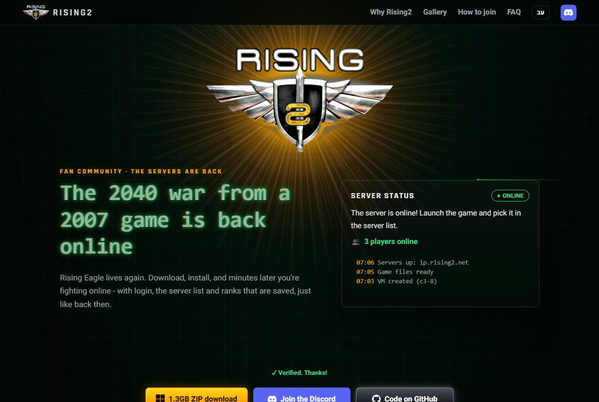
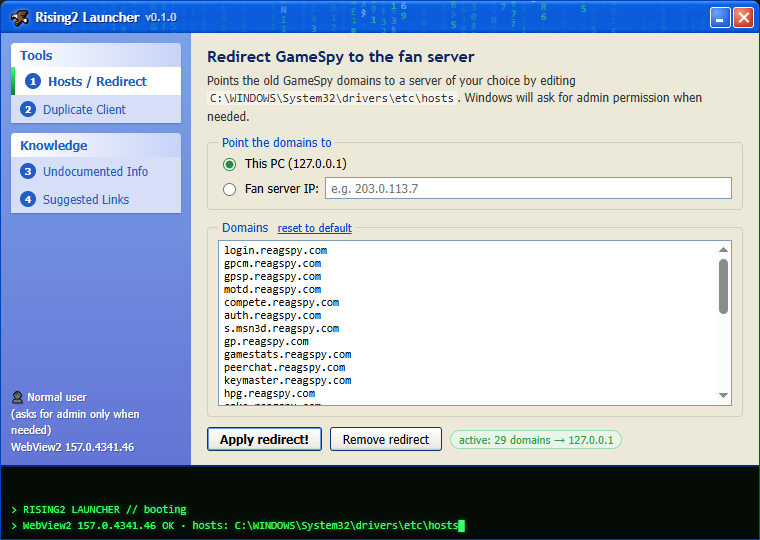
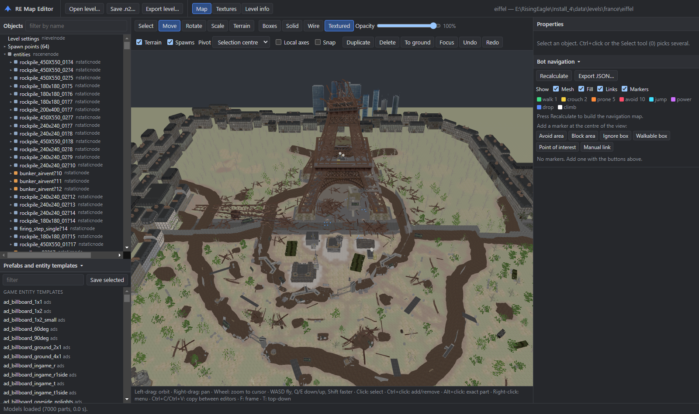
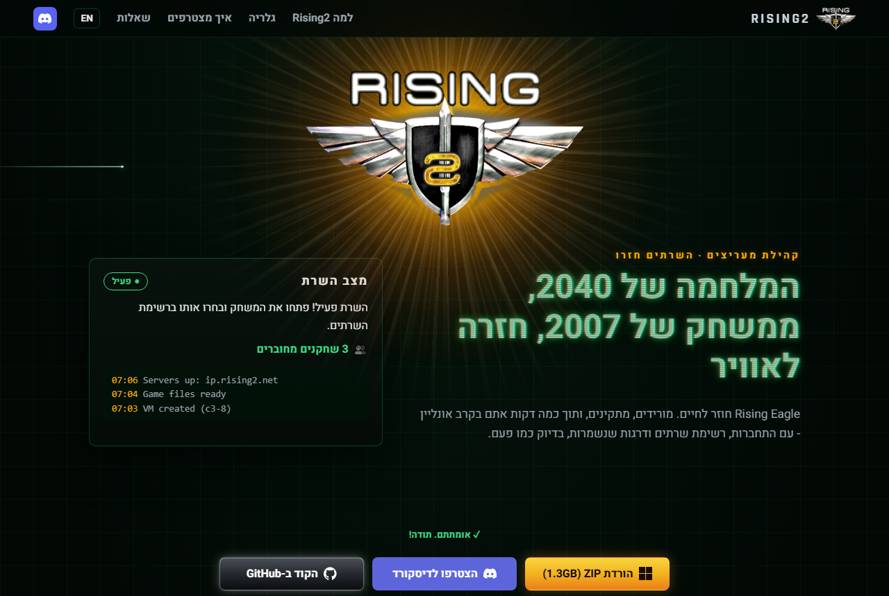

# Rising2

Everything the **Rising2** fan community uses to bring **Rising Eagle** (PC, 2008) back online:
login, server list, saved ranks, dedicated servers, a launcher for players, a map editor, and a
server that costs ~0$ while nobody plays.



## Why

GameSpy shut down in 2014, and with it everything the game needs to play online: login, the server
list, stats and ranks. The game still works, it just has nobody to talk to. Rising2 puts back each
piece the game expects, without changing the game itself:

* **Same protocols, our server.** The game and the official dedicated server keep talking "GameSpy";
  the domains point to our stand-in instead.
* **Ranks are real again.** Matches on the official server are reported, scored and saved, like in 2008.
* **Cheap to keep alive.** A retro game has quiet weeks. The server VM exists only while people play,
  and anyone can wake it from the website or Discord.
* **Easy for players.** One launcher does the hosts redirect and the old tricks; no manual setup.
* **Open, and new content.** All code is here, and the map editor makes new levels possible.

## Modules

| Module | What | Why | Built with |
|---|---|---|---|
| [GameSpy_UnifiedServer](GameSpy_UnifiedServer/) | Every GameSpy service the game uses (login, server list, QR2, CD key, Auth, Sake, Competition) in one container | Online play needs it; it also **saves stats/rank** from the official server's reports | Python (stdlib), SQLite, Docker |
| [ServerLauncher](ServerLauncher/) | `r2launch.exe`: logs the official dedicated server in, picks a profile, presses Start | The 2008 server only starts by clicking; this makes it run unattended (Docker + Wine) | C, Win32 |
| [Launcher](Launcher/) | Player pre-launcher: hosts redirect, duplicate client, undocumented info, links | One click to point the game at the fan server; replaces REExtraUtils | Go + WebView2 |
| [MapEditor](MapEditor/) | Opens, edits and exports Rising Eagle (Nebula 2) levels; bot navmesh | New maps and changes to old ones | Electron, three.js, Recast |
| [DeployProjects](DeployProjects/) | Website, Cloudflare Worker, on-demand OVH VM, step-by-step deploy | Run all of the above for ~0$ while idle | HTML/JS, CF Workers + R2, bash, Docker |
| [Docs](Docs/) | Research PDFs: wire format, revival findings, hosting price comparisons | Background for the decisions above | |

### DeployProjects in short

| Part | What |
|---|---|
| [LandingPage](DeployProjects/LandingPage/) | `rising2.net`: Hebrew/English page, live server status, **Wake the server** |
| [CF-Worker](DeployProjects/CF-Worker/) | `rising2.net/api/*`: start/stop the VM, status log, DNS, Discord `/start` `/status` `/stop` |
| [LazyServer](DeployProjects/LazyServer/) | VM boot script + compose: GameSpy server, official (ranked) and fun dedicated servers; tears itself down when empty |
| [Deploy](DeployProjects/Deploy/) | Small, re-runnable steps (each with deploy / undeploy) that set it all up on your own accounts |
| [SiteData](DeployProjects/SiteData/) | Links and file archive the page shows after its captcha |

## How it fits together

```
Player PC                                     On-demand VM (OVH)
┌──────────────────┐   hosts redirect         ┌───────────────────────────────────┐
│ Rising2 Launcher │ ───────────────┐         │ GameSpy_UnifiedServer  (gamespy)  │
│ Rising Eagle     │ ── *.reagspy ──┼───────> │ ServerLauncher + official server  │
└──────────────────┘                          │ ServerLauncher + fun server       │
                                              └───────────────▲───────────────────┘
rising2.net (LandingPage) ─┐                                  │ create / delete
Discord /start /stop ──────┴──> CF-Worker (+ R2 state) ───────┘
```

## Screenshots

| Launcher | Map Editor |
|---|---|
|  |  |

| Landing page (English) | Landing page (Hebrew, default) |
|---|---|
|  |  |

The server-side modules have no UI of their own: GameSpy_UnifiedServer has an admin CLI and JSON pages,
ServerLauncher drives the original server's window, and the deploy steps run in a terminal.

## Start here

* **Play:** get the game + launcher from [rising2.net](https://rising2.net), run the launcher, *Apply redirect*.
* **Run a server locally:** `docker compose up -d --build` in [GameSpy_UnifiedServer](GameSpy_UnifiedServer/)
  and [ServerLauncher](ServerLauncher/).
* **Host it the 0$-idle way:** follow [DeployProjects/Deploy](DeployProjects/Deploy/).
* **Make a map:** `npm install && npm start` in [MapEditor](MapEditor/).
